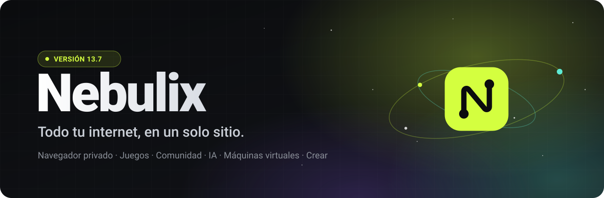
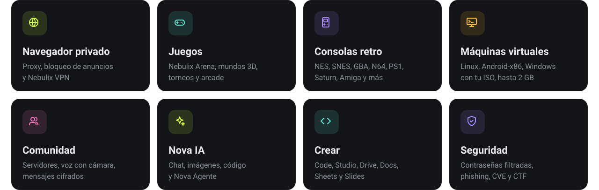

<p align="center">
  <a href="https://nebulix.fly.dev"></a>
</p>

<p align="center">
  <a href="../../releases/latest"></a>
  <a href="https://nebulix.fly.dev"></a>
  <a href="../../actions/workflows/release.yml"></a>
  <a href="../../releases/latest"></a>
</p>

<p align="center">
  
  
  
  
  
</p>

<h3 align="center">
  <a href="https://nebulix.fly.dev">Abrir Nebulix</a>
  &nbsp;·&nbsp;
  <a href="../../releases/latest">Descargar las apps</a>
  &nbsp;·&nbsp;
  <a href="#-ejecutarlo-en-tu-ordenador">Ejecutarlo tú mismo</a>
</h3>

<br>

## ✦ Qué es Nebulix

**Nebulix** es una plataforma web completa creada por **VicStyles**: navegador privado, juegos online, comunidad, inteligencia artificial, herramientas para crear, consolas retro y máquinas virtuales, todo en una sola web.

Funciona en cualquier navegador moderno (también en **Chromebooks** y **móviles**) sin instalar nada, y además tiene app para **Android** y **Windows**.

> [!TIP]
> Una misma cuenta sirve en la web, en el móvil y en el PC: tus monedas, amigos, partidas y archivos van contigo.

<br>

<p align="center">
  
</p>

<br>

## ✦ Funciones

<table>
<tr>
<td width="50%" valign="top">

### 🌐 Navegador privado
Proxy web con bloqueo de anuncios y rastreadores, pestañas, perfiles y **Nebulix VPN** (identidad genérica y protección contra fugas WebRTC dentro de Nebulix).

### 📚 Nebulix Estudio
Apuntes compartidos por estudiantes, tarjetas con **repetición espaciada**, **tutor de IA**, tests y resúmenes con IA, **quizzes en directo para clase** con PIN, control de notas y planificador de exámenes con avisos.

### 🎮 Juegos
**Nebulix Arena**: battle royale con construcción y edición, 5 contra 5, duelos y peleas de construcción 1 contra 1 (**Realistas** y **Pelea en caja**), con bots, clasificatoria y menú de ajustes completo. También **Nebula Worlds** (mundos 3D), casino 3D con monedas virtuales (ruleta, blackjack, bacará, video póker, Hi-Lo, crash, mines, plinko y más), torneos, ligas, World Boss y arcade.

### 🕹️ Consolas retro
NES, SNES, Game Boy / GBA, DS, N64, PlayStation, Saturn, Mega Drive, Sega CD, 32X, 3DO, Atari, Neo Geo Pocket, Commodore 64, Amiga y más, con tus propios archivos.

### 🖥️ Máquinas virtuales
Un PC x86 emulado en el navegador: Linux con terminal real, Damn Small Linux, FreeDOS, KolibriOS, OpenBSD, Oberon, **Android-x86**, y Windows 98 / 2000 / XP o ReactOS con tu propia ISO. Hasta **2 GB de RAM**, discos de **32 GB**, instantáneas, **pantalla de BIOS**, menú de teclas especiales, pegar texto, capturas y un **reproductor de Android** con botones de Atrás, Inicio y Apps recientes.

</td>
<td width="50%" valign="top">

### 🧪 Juegos propios
**Nebula Fusion** (combina elementos; la IA inventa los resultados) y **Nebula Dash** (runner rítmico con 4 vehículos, 5 niveles y editor de niveles).

### 💬 Comunidad
Servidores con canales, roles, bots y moderación; mensajes privados **cifrados de extremo a extremo**; voz con cámara y pantalla compartida; Echo, Clips, TV, Lens y foros.

### ✨ Nova IA
Asistente de chat con búsqueda web, imágenes, modo código y **Nova Agente** (PRO), que trabaja en tus proyectos con tu permiso.

### 🛠️ Crear
**Nebulix Code** (repositorios, commits, issues y pull requests), Studio con copiloto, Hub para publicar juegos y vídeos, **Nebula Vault** (tienda de juegos), Drive, Docs, Sheets y Slides.

### 👑 Nebulix Premium
Tres planes opcionales —**Premium**, **Premium Pro** y **Premium Ultimate**— con más IA, archivos más grandes y más ventajas. Nunca venden monedas.

### 💰 Economía
Monedas, Tienda diaria con exclusivos, Taquilla 3D, mercado entre jugadores y un sistema que ajusta los precios según la economía real.

### 🛡️ Seguridad
Laboratorio con comprobación de contraseñas filtradas (k-anonimato), análisis de webs, detector de phishing, cifrados, JWT, CVE y retos CTF.

</td>
</tr>
</table>

<br>

## ✦ Descargar las apps

<p align="center">
  <a href="../../releases/latest"></a>
  &nbsp;
  <a href="../../releases/latest"></a>
</p>

En cada versión de **[Releases](../../releases/latest)** encontrarás:

| Archivo | Para | Requisitos |
|---|---|---|
| `Nebulix-x.y.z.apk` | 📱 Android | Android 7.0 o superior |
| `Nebulix-Setup-x.y.z.exe` | 💻 Windows (instalador) | Windows 10 / 11, 64 bits |
| `SHA256SUMS.txt` | 🔒 Verificación | Comprueba que los archivos no se han modificado |

Las dos apps son una ventana segura a Nebulix:

- ✅ solo HTTPS y solo certificados del sistema;
- ✅ solo las direcciones de Nebulix se abren dentro de la app (el resto, en tu navegador normal);
- ✅ la web no tiene acceso a tus archivos, ni a Android ni a Windows;
- ✅ cámara y micrófono solo cuando Nebulix los pide (salas de voz y videollamadas);
- ✅ si la dirección principal no responde, prueban solas las direcciones espejo.

> [!NOTE]
> **Windows** puede mostrar «Windows protegió su PC» porque el instalador aún no lleva firma de código de pago: pulsa *Más información → Ejecutar de todas formas*.
> En **Android** tendrás que permitir «instalar apps de origen desconocido» para tu navegador.

Las apps se compilan automáticamente con GitHub Actions desde el código de [`apps/`](apps) cada vez que se publica una versión.

<br>

## ✦ Direcciones

Todas son **el mismo servidor**: misma cuenta, mismas monedas y mismos datos.

| | Dirección |
|---|---|
| ⭐ Principal | **https://nebulix.fly.dev** |
| 🔁 Espejo | https://nebulix-play.fly.dev |
| 🔁 Espejo | https://nebulix-zone.fly.dev |
| 🔁 Espejo | https://nebulix-hq.fly.dev |

<br>

## ✦ Ejecutarlo en tu ordenador

Solo necesitas **Node.js 22 o superior**. No hay que instalar paquetes.

```bash
git clone https://github.com/VIcStyless/nebulix.git
cd nebulix
./scripts/fetch-vm-images.sh   # opcional: imágenes libres para las máquinas virtuales
node server/index.js
```

Abre **http://localhost:3000**. Los datos se guardan en `./data`.

<details>
<summary><b>Opciones del servidor</b></summary>

<br>

| Variable | Para qué |
|---|---|
| `PORT` | Puerto (por defecto `3000`). |
| `APP_ORIGIN` | Dirección pública de la app (p. ej. `https://nebulix.fly.dev`). |
| `PROXY_ORIGIN` | Dirección **distinta** para el proxy de navegación (aísla las webs visitadas de tu cuenta). |
| `GAMES_ORIGIN` | Dirección distinta para los juegos del Hub y los emuladores. |
| `MIRROR_HOSTS` | Direcciones espejo separadas por comas. |
| `DATA_DIR` | Carpeta donde se guardan los datos. |

</details>

<details>
<summary><b>Desplegar en Fly.io</b></summary>

<br>

```bash
fly deploy                                   # la app principal (fly.toml)
fly deploy -c deploy/fly.nebulix-play.toml   # un espejo (reenvía al mismo servidor)
```

</details>

<br>

## ✦ Estructura

```
server/           servidor Node.js (API, WebSockets, proxy, juegos, economía, IA)
  routes/         rutas de la API por área
  proxy/          motor del proxy de navegación
public/           la web (sin compilación: módulos ES)
  js/views/       cada sección de la app
  vm/             emulador v86 y fuentes de las imágenes libres
apps/android/     app de Android (Java, WebView reforzada)
apps/windows/     app de Windows (Electron + instalador NSIS)
deploy/           espejos de Fly.io
scripts/          utilidades de administración
```

<br>

## ✦ Seguridad

- 🔐 Contraseñas con hash, sesiones con cookies `HttpOnly` / `Secure` y verificación en dos pasos.
- 🧱 Políticas CSP estrictas, el proxy en un origen separado, protección SSRF y límites de peticiones.
- 🙈 Este repositorio no contiene datos de usuarios.
- 🐞 ¿Has encontrado un fallo de seguridad? Lee [SECURITY.md](SECURITY.md) y avisa en privado, nunca en un issue público.

<br>

## ✦ Software de terceros

Nebulix usa componentes libres, cada uno con su licencia:
[three.js](https://threejs.org) (MIT) ·
[xterm.js](https://xtermjs.org) (MIT) ·
[v86](https://github.com/copy/v86) (BSD-2) ·
[EmulatorJS](https://emulatorjs.org) (GPLv3, cargado desde su CDN en un dominio aislado) ·
[Monaco Editor](https://microsoft.github.io/monaco-editor/) (MIT) ·
imágenes de sistemas listadas en [`public/vm/SOURCES.txt`](public/vm/SOURCES.txt).

Nebulix no incluye juegos comerciales ni Windows.

<br>

## ✦ Licencia

© VicStyles. **Todos los derechos reservados.** El código es público para que puedas verlo y aprender de él, pero no se concede permiso para copiarlo, redistribuirlo ni publicar versiones propias sin autorización del autor. Los componentes de terceros mantienen sus propias licencias.

<br>

<p align="center">
  
</p>
